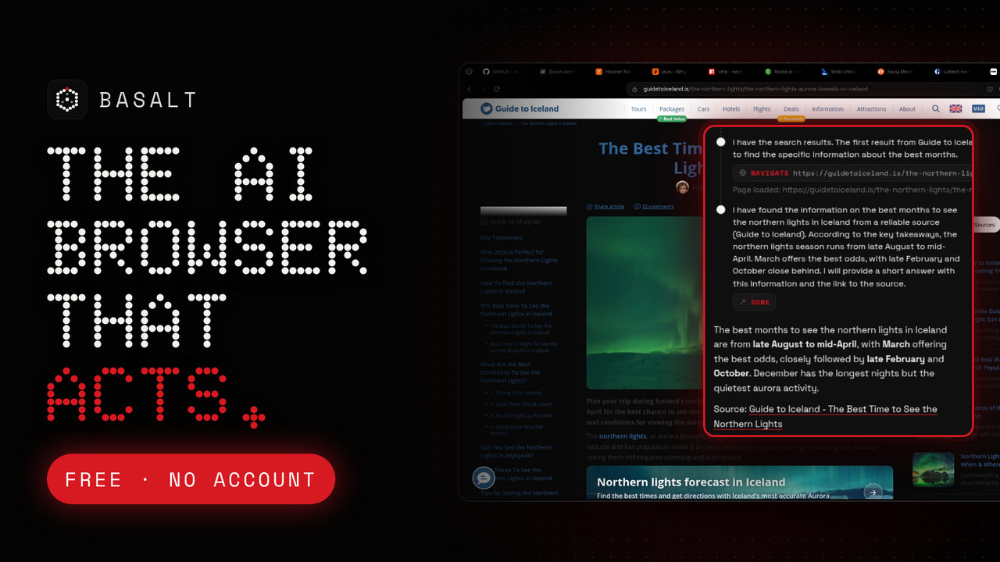
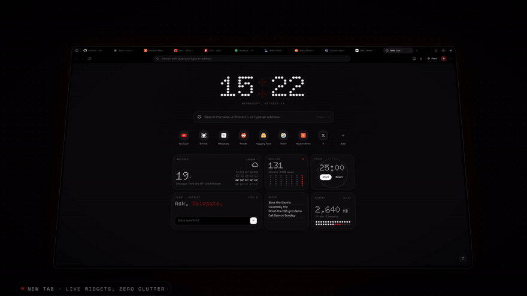
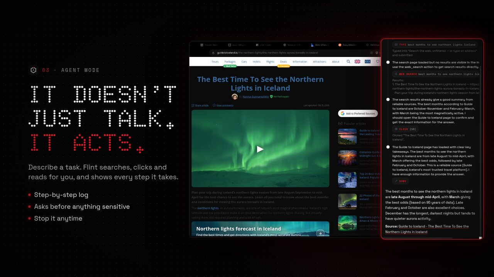
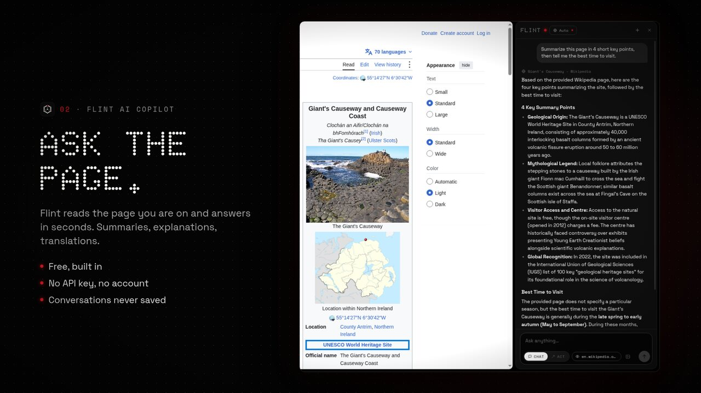
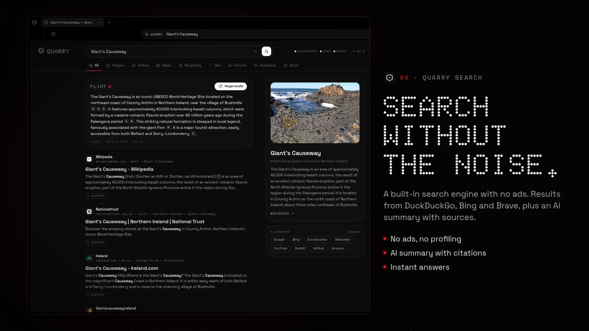
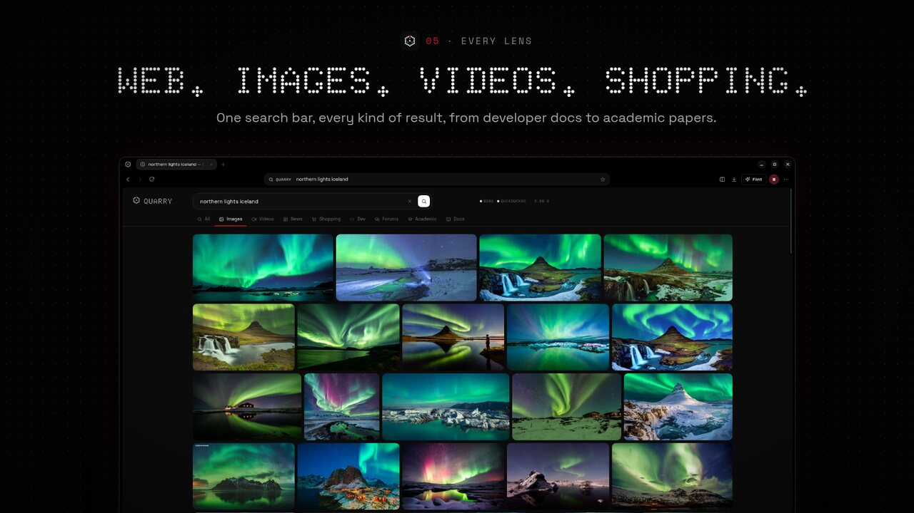
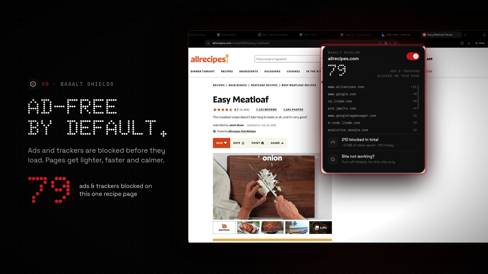
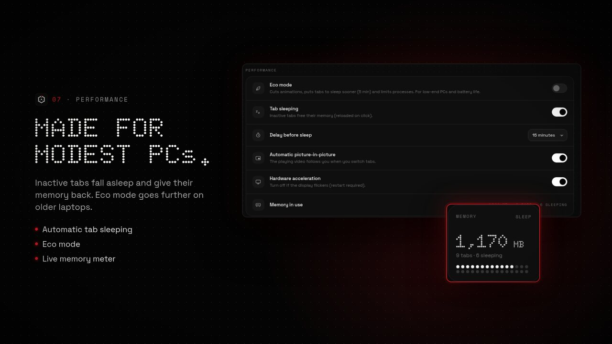

# BASALT

**Le navigateur léger, beau et honnête.** · *The light, beautiful and honest browser.*

### [⬇ Télécharger pour Windows / Download for Windows](https://github.com/mouusieur/basalt/releases/latest)

Windows 10 · 11 (64 bits) — gratuit, sans pub, sans compte, sans clé API · *free, no ads, no account, no API key*

[Confidentialité / Privacy](PRIVACY.md) · [FAQ](FAQ.md) · [Signaler un problème / Report a problem](https://github.com/mouusieur/basalt/issues/new)

 

Vraies captures d'écran de Basalt, sans aucune image générée par IA · <i>Real screen recordings, no AI-generated images</i>

---

## Aperçu · Preview

<table>
<tr>
<td width="50%"> <b>Flint · mode agent</b> — il cherche, clique et lit pour vous, chaque étape est affichée. <i>Agent mode: it searches, clicks and reads for you, every step shown.</i></td>
<td width="50%"> <b>Flint · copilote IA</b> — résumez ou interrogez n'importe quelle page, gratuitement. <i>Ask any page, for free.</i></td>
</tr>
<tr>
<td> <b>Quarry</b> — moteur de recherche intégré, sans pub, avec résumé IA sourcé. <i>Built-in search, no ads, AI summary with sources.</i></td>
<td> <b>Web · Images · Vidéos · Shopping</b> — tout au même endroit. <i>Everything in one place.</i></td>
</tr>
<tr>
<td> <b>Shields</b> — pubs et traqueurs bloqués avant de charger. <i>Ads and trackers blocked before they load.</i></td>
<td> <b>Pour les PC modestes</b> — mise en veille des onglets : jusqu'à −80 % de mémoire. <i>Tab sleeping: up to −80% memory.</i></td>
</tr>
</table>

---

## 🇫🇷 Français

Basalt est un navigateur pour Windows inspiré du design Nothing (typographie à points, noir profond, accent rouge). Il est pensé pour **les PC modestes** comme pour les développeurs.

- **Rapide et léger** : onglets mis en veille automatiquement, mode éco pour les vieux PC.
- **Basalt Shields** : bloqueur de publicités et de traqueurs intégré, activé par défaut.
- **Quarry** : moteur de recherche intégré, sans serveur et sans pub. Web, images, vidéos, actualités, shopping et développeurs.
- **Flint** : assistant IA gratuit, **sans clé ni compte**. Il résume une page, répond à vos questions, décrit une image… En **mode agent**, il agit dans un onglet pour vous : chercher, cliquer, garder et copier des images, résumer une vidéo avec ses moments clés.
- **Pour les développeurs** : panneau développeur, écran partagé, onglets verticaux, palette de commandes (Ctrl K).
- **Sécurité** : coffre de mots de passe chiffré, comptes protégés (double authentification), mises à jour signées.
- **Extensions Basalt** : petite bibliothèque de modules vérifiés, à activer au choix; aucune installation arbitraire du Chrome Web Store. Les modules ne tournent pas en fenêtre privée; aucun VPN n’est actuellement proposé.
- **Vie privée par défaut** : aucune télémétrie sans consentement, pas de compte obligatoire ni de synchronisation cloud. Le compteur communautaire est facultatif et désactivé par défaut. [Tout est expliqué ici](PRIVACY.md).

**Installation :** téléchargez `Basalt-Setup-x.y.z.exe` depuis la [dernière version](https://github.com/mouusieur/basalt/releases/latest) et lancez-le. Aucun droit administrateur n'est nécessaire. Si Windows affiche « Windows a protégé votre ordinateur », cliquez sur **Informations complémentaires → Exécuter quand même** ([pourquoi ?](FAQ.md)).

## 🇬🇧 English

Basalt is a Windows browser inspired by Nothing's design (dot-matrix type, deep black, red accent). It is built for **modest PCs** and for developers alike.

- **Fast and light**: automatic tab sleeping, eco mode for older PCs.
- **Basalt Shields**: built-in ad and tracker blocker, on by default.
- **Quarry**: built-in search engine with no server and no ads. Web, images, videos, news, shopping and developer results.
- **Flint**: free AI assistant, **no key and no account**. It summarizes a page, answers your questions, describes an image… In **agent mode**, it acts in a tab for you: search, click, keep and copy images, summarize a video with its key moments.
- **For developers**: developer panel, split view, vertical tabs, command palette (Ctrl K).
- **Security**: encrypted password vault, protected accounts (two-factor), signed updates.
- **Basalt Extensions**: a small, vetted add-on library you can opt into; no arbitrary Chrome Web Store installs. Add-ons do not run in private windows; no VPN add-on is currently offered.
- **Privacy by default**: no telemetry without consent, no mandatory account or cloud sync. The community counter is optional and off by default. [Everything is explained here](PRIVACY.md).

**Install:** download `Basalt-Setup-x.y.z.exe` from the [latest release](https://github.com/mouusieur/basalt/releases/latest) and run it. No administrator rights needed. If Windows says "Windows protected your PC", click **More info → Run anyway** ([why?](FAQ.md)).

---

© 2026 Basalt Labs · [Licence / License](LICENSE.md) · mouusieur@gmail.com

